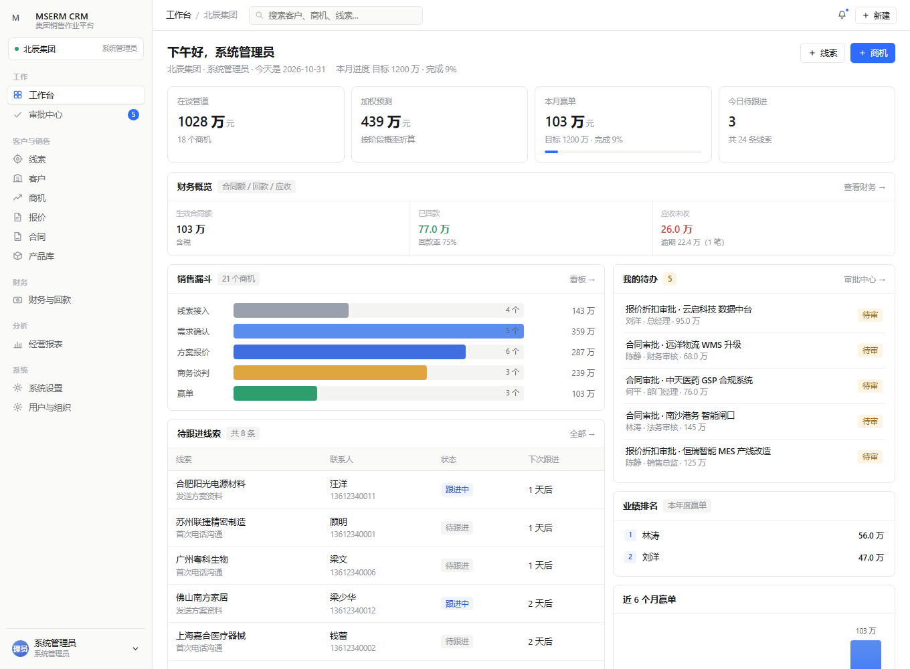
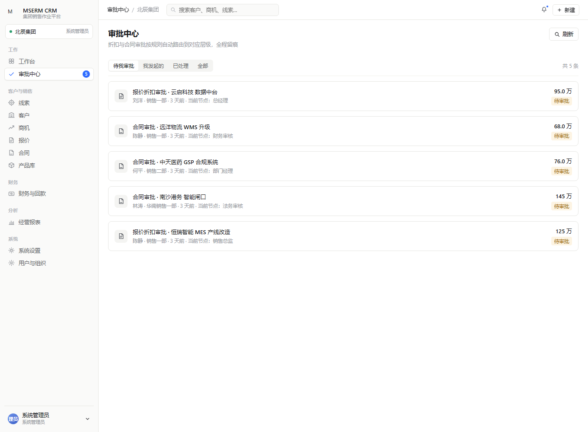
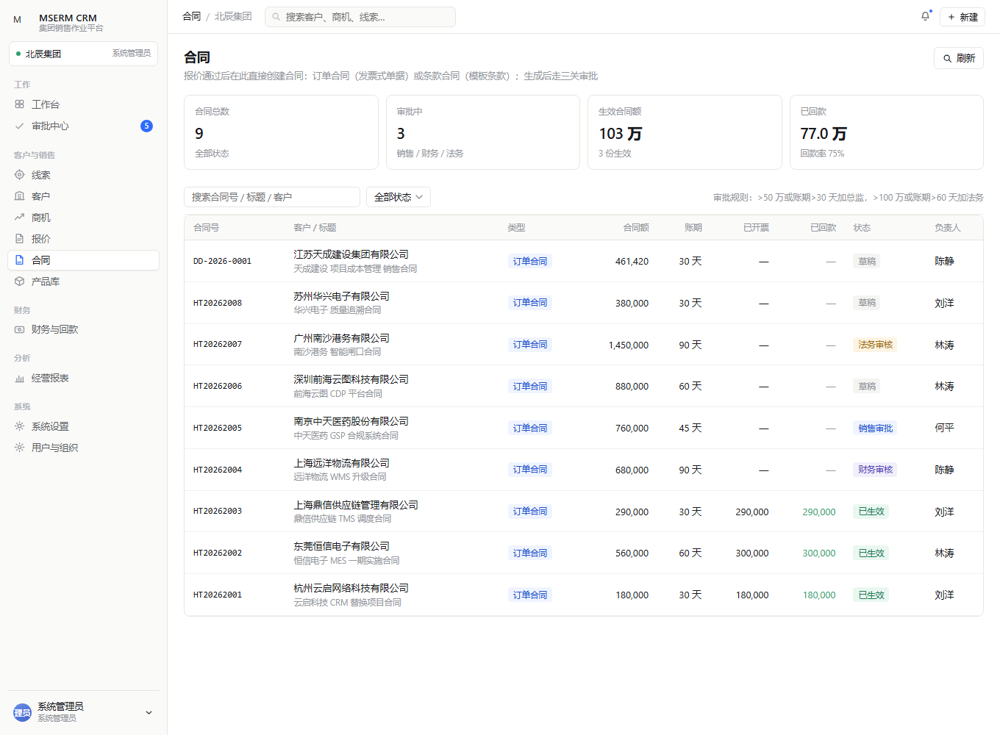
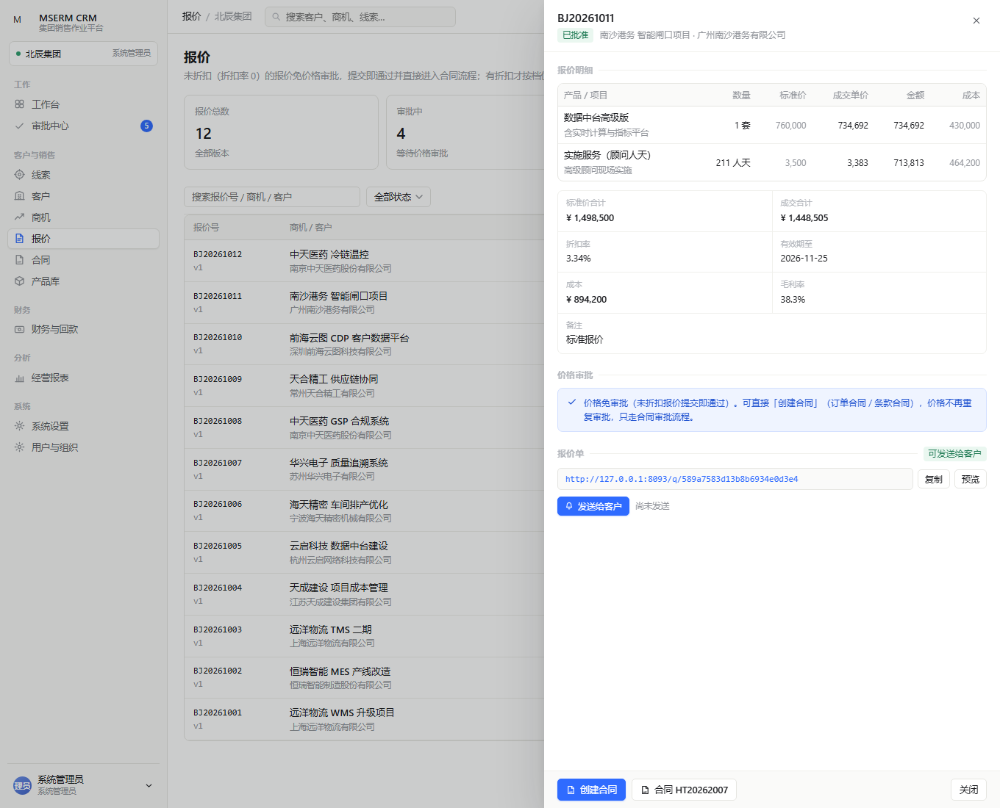
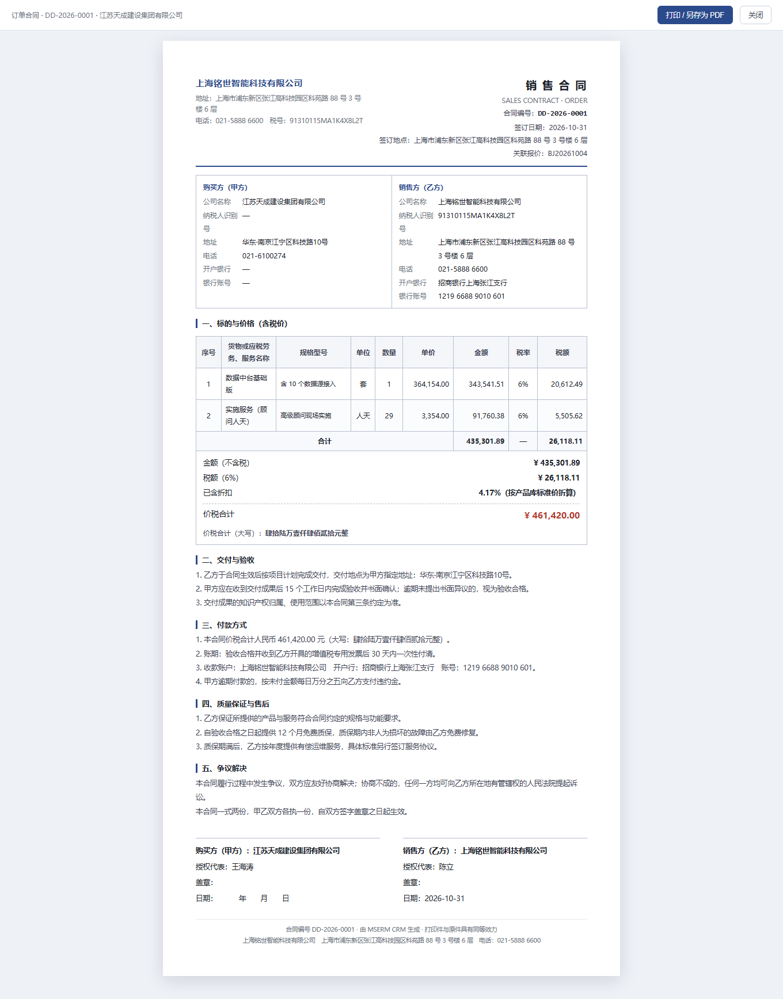
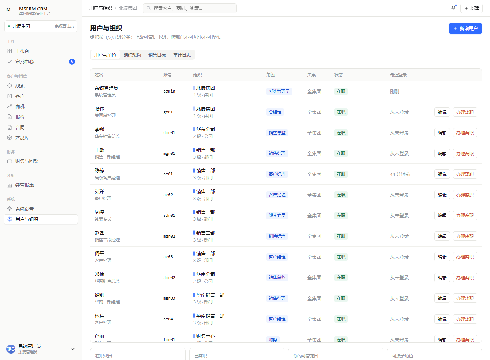
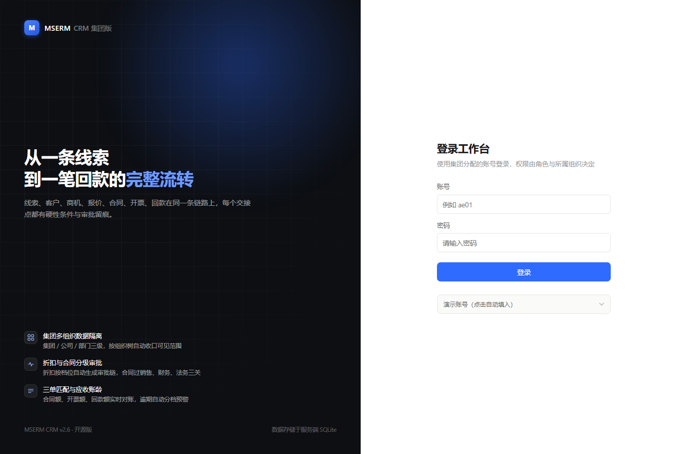
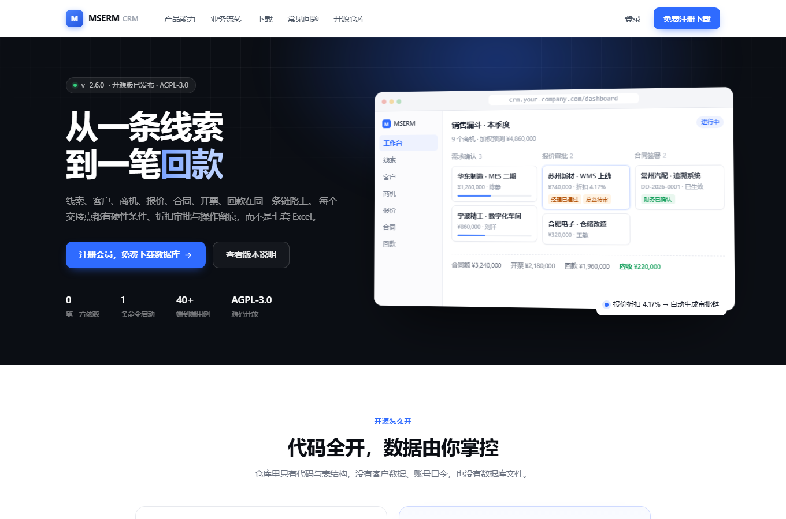
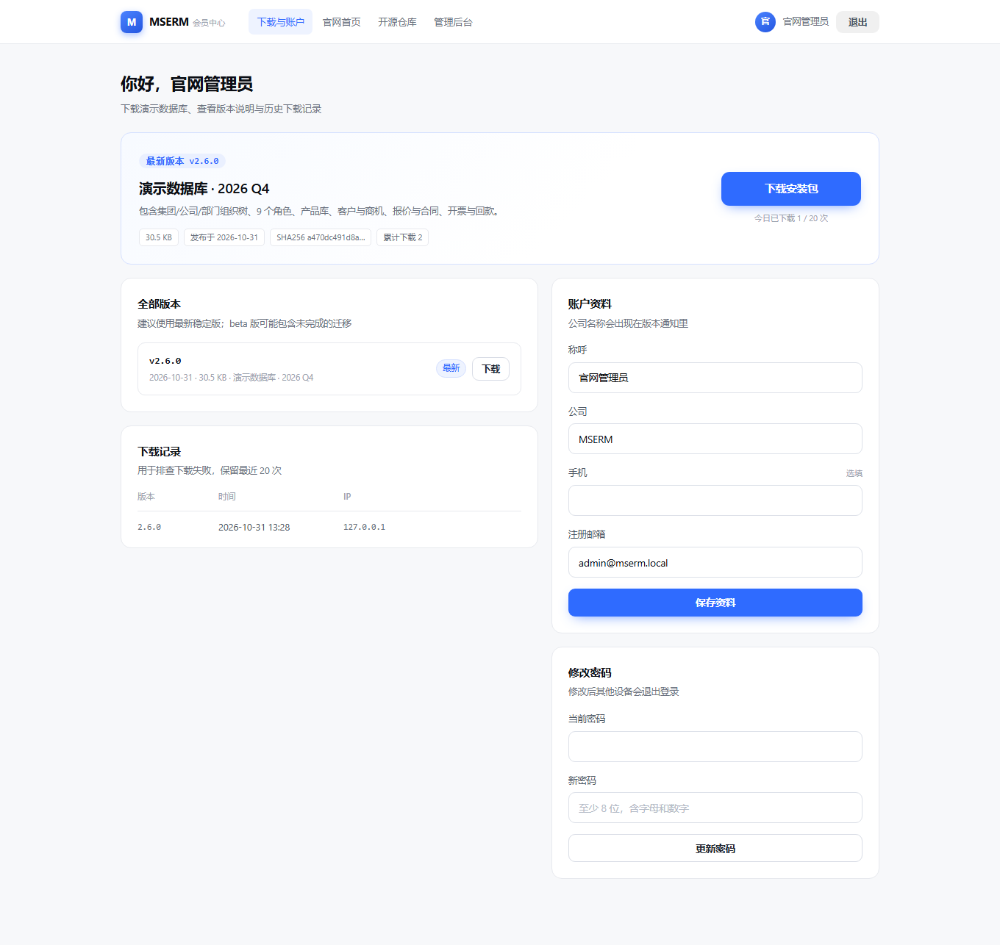
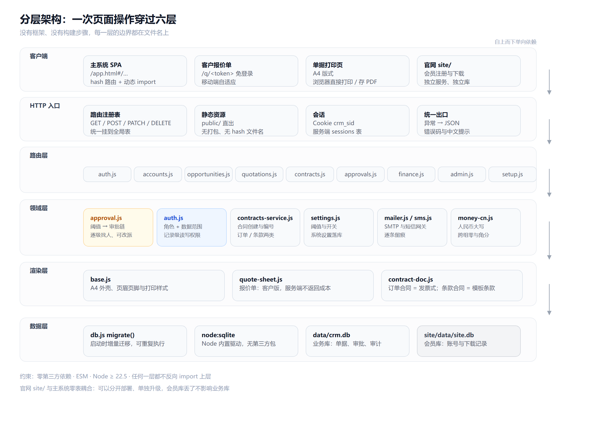

# MSERM CRM · 开源的集团级销售与回款管理系统

线索 → 客户 → 商机 → 报价 → 合同 → 开票 → 回款，在同一条链路上跑完。
每个跨部门交接点都有硬性校验、折扣审批与操作留痕，而不是七套对不上的 Excel。

**Node 22 · 默认内置 SQLite（零外部依赖）· 可选 PostgreSQL · 无构建步骤 · 一条命令启动**

[](LICENSE)
[](https://nodejs.org)
[](package.json)

**仓库**：[Gitee（主）](https://gitee.com/Emcloud_admin/mserm-crm) · [GitHub（镜像）](https://github.com/mserm/mserm-crm)

---

## ⚠️ 先看这里：仓库里没有数据库

本仓库**只包含代码与数据库表结构**，不附带任何 `.db` 文件。

| | 开源仓库 | 官网会员（免费） |
|---|---|---|
| 完整前后端源码 | ✅ | — |
| 表结构与自动迁移 | ✅ | — |
| 安装向导（自建空库） | ✅ | — |
| 审批引擎 / 权限模型 / 单据渲染 | ✅ | — |
| 演示数据库（组织、产品、客户、商机、报价、合同、回款） | ❌ 不提供 | ✅ 注册后下载 |
| 版本更新通知 | — | ✅ |

- 想**自己从零开始**：clone 代码 → `npm start` → 打开 `/setup.html` 创建集团与管理员，即可使用。
- 想**直接体验完整流程**：到官网注册会员 → 会员中心下载演示数据库 → 放进 `data/crm.db` → 启动。

> 销售官网（会员注册、受控下载、在线测试）是**独立项目**，不在本仓库，单独部署与维护。

### 为什么不在仓库里放数据库

1. **数据不是源码**。演示库会随业务演进频繁变化，放进 Git 只会让仓库不断膨胀、历史难以回溯。
2. **安全**。数据库里有密码哈希、客户联系方式、合同金额，一旦提交就很难从历史中彻底清除。
3. **升级更清晰**。代码与数据分离后，`git pull` 不会覆盖你的业务数据，版本升级只需跑迁移。

---

## 快速开始（空库，2 分钟）

前置条件：**Node.js ≥ 22.5**（需要内置的 `node:sqlite`）。不需要 Docker、MySQL、Redis，也**不需要 `npm install`**。

```bash
# 国内推荐 Gitee
git clone https://gitee.com/Emcloud_admin/mserm-crm.git
# 或 GitHub
# git clone https://github.com/mserm/mserm-crm.git

cd mserm-crm
cp .env.example .env       # 可选，改端口/数据库路径
npm start
```

打开 <http://localhost:8081>，会自动跳到安装向导 `/setup.html`：

1. 填写企业名称（作为组织树的集团根节点）
2. 设置管理员姓名、登录账号、密码
3. 提交后即可用该账号登录

安装向导只在空库时出现，创建成功后自动失效（再次访问会跳回登录页）。

局域网内其他电脑访问 `http://<本机IP>:8081`。

---

## 获取演示数据库（官网会员，免费）

演示库包含一套可直接登录、可直接走审批的完整数据：

- 集团 / 公司 / 部门 / 团队四级组织，9 个角色共 14 个账号
- 12 个产品、18 家客户、24 条线索、22 个商机
- 12 份报价（含折扣审批与例外项）、8 份合同（订单合同 + 条款合同）
- 发票、回款、应收账龄，以及三套内置合同条款模板

**获取步骤**

1. 打开官网（本机部署则为 `http://localhost:8099`），点击「免费注册下载」
2. 用邮箱注册会员（配置 SMTP 时会发验证码；未配置时验证码直接打印在服务端日志）
3. 进入会员中心，下载最新版安装包（`.zip`，内含 `crm.db` 与 `INSTALL.md`）
4. 解压后把 `crm.db` 放到项目的 `data/` 目录，`npm start`

演示账号统一密码 `crm123456`，登录后请立即修改：

| 账号 | 姓名 | 角色 |
|---|---|---|
| `admin` | 系统管理员 | 管理员（组织、用户、审计、全部业务） |
| `gm01` | 张伟 | 集团总经理 |
| `dir01` | 李强 | 华东销售总监 |
| `mgr01` / `mgr02` | 王敏 / 赵磊 | 销售部经理 |
| `ae01` / `ae02` / `ae04` | 陈静 / 刘洋 / 林涛 | 客户经理 |
| `sdr01` | 周婷 | 线索专员 |
| `fin01` | 孙丽 | 财务经理 |
| `legal01` | 吴峰 | 法务顾问 |

> 官网与主系统相互独立：官网只管会员与安装包分发，不接触你的业务数据。

## 界面一览

截图全部取自仓库配套的演示库（官网会员免费下载），不是设计稿。

**工作台**：本月漏斗、加权预测、待跟进线索、我的待办、业绩排名



| 审批中心：谁的单、卡在哪一关 | 合同：报价通过后一键建单 |
|---|---|
|  |  |

**报价**：明细、折扣、成本毛利、客户版链接、发送记录



**订单合同**：中国发票版式，购买方/销售方、明细含税率税额、价税合计大写



| 用户与组织：四级组织树、分级管理 | 登录页：演示账号按库类型切换 |
|---|---|
|  |  |

| 官网：会员注册与受控下载 | 会员中心：版本、配额、下载记录 |
|---|---|
|  |  |

---

## 功能地图

**线索**：线索池、状态机（待跟进 → 跟进中 → 已确认 → 已转商机 / 无效）、跟进记录、转商机四要素硬校验。

**客户与联系人**：公司档案、联系人角色、归属与共享、批量转让（离职交接用）。

**商机**：七阶段看板（可拖拽）、阶段推进必填证据、金额与赢率、赢单绑定「合同已生效」。

**产品与报价**：产品库统一价目、成本与最低价（对无权限角色在服务端剔除）、多版本报价、折扣自动计算、例外商品单独录入、报价单公开链接（`/q/<token>`，免登录、移动端自适应）。

**报价送达**：生成 A4 报价单，邮件（零依赖 SMTP）与短信（HTTP 网关）双通道发送，逐条留痕；未配置通道时标记「模拟发送」并给出原因。

**合同**：订单合同（按中国发票版式：购买方/销售方、明细含税率税额、价税合计大写）与条款合同（套模板自动填充甲乙方、金额、编号）；合同编号 `DD-YYYY-0001` / `HT-YYYY-0001` 自增。

**财务**：开票、回款登记、回款核销、应收账龄分档、三单匹配（合同额 = 开票额 = 回款 + 应收）。

**审批**：折扣审批（≤5% 经理，5–10% 加总监，>10% 加总经理，阈值可配；**未让价免价格审批**，直接进入合同流程）；合同审批三关（销售 → 财务 → 法务）。每关指定到人、支持改派、缺人时明确报错而不是静默跳过。

**组织与权限**：四级组织树、9 个角色、数据范围（本人 / 本部门 / 本公司 / 全集团）、字段级脱敏、分级管理（谁能管理谁）。

**对外 API（线索）**：管理员在「用户与组织 → API 接入」开通，生成密钥并授权 IP 与限额；官网表单、企业微信或第三方系统可经 `POST /api/v1/leads` 直接推送线索（带 `external_id` 幂等去重），含接口调试台与调用日志。详见 [`docs/15`](docs/15-线索API接口(v1).md)。

**离职交接**：先交接客户与商机，再停用账号；账号进入 `leaving → left` 状态，再次登录会明确告知离职时间与接手人。

---

## 技术结构



```
.
├── server.js                 # 主系统入口（原生 http，静态资源 + API）
├── src/
│   ├── db.js                 # node:sqlite 连接、建表、增量迁移（含内置合同模板）
│   ├── http.js               # 路由注册表、鉴权中间件、JSON 解析
│   ├── auth.js               # 会话、角色、数据范围、分级管理、离职状态
│   ├── approval.js           # 审批引擎：要不要审 → 谁来审 → 逐关推进
│   ├── contracts-service.js  # 合同创建（价格锁定、编号、模板替换）
│   ├── settings.js           # 业务规则开关（阈值、抬头、SMTP、短信）
│   ├── mailer.js / sms.js    # 零依赖 SMTP / 短信网关
│   ├── money-cn.js           # 人民币金额大写
│   ├── doc/                  # A4 单据渲染（报价单、合同）
│   ├── routes/               # 按业务域拆分的 REST 接口
│   └── setup.js              # 首次安装：空库 → 集团 + 管理员
├── public/                   # 原生 JS 单页（hash 路由 + 动态 import）
├── docs/                     # 设计、数据模型、权限矩阵、部署、验证报告
└── data/                     # 运行时数据（不进版本库）
```

**几个关键设计决策**

- **零依赖**：全部使用 Node 内置模块。`node:sqlite` 提供 WAL、事务、外键；`node:crypto` 提供 scrypt 口令散列。
- **权限在 SQL 里收口**：数据范围用组织树 `path` 前缀（`/1/2/3/`）实现，一个 `LIKE` 覆盖本人/部门/公司/全集团，`scopeFilter()` 是所有列表与详情的唯一入口。
- **字段级脱敏在服务端删除字段**：成本、毛利对业务员直接不存在，前端拿不到就没有越权查看的可能。
- **审批可分两步**：「要不要审」与「谁来审」是两个函数。0% 折扣不生成空转审批单，这是实际使用中最容易踩的坑。
- **状态机在服务端**：报价 `draft → approved → converted`，合同 `draft → pending → active`，前端只是展示。
- **单据是 HTML 不是 PDF**：A4 尺寸 + `@page` 打印样式，浏览器直接打印/另存 PDF，避免引入 PDF 库。

分层、请求链路、数据模型、审批链的完整说明见 [`docs/14-架构与开发逻辑.md`](docs/14-架构与开发逻辑.md)；权限矩阵见 [`docs/07-权限与流转矩阵.md`](docs/07-权限与流转矩阵.md)。

---

## 权限与审批

| 角色 | 数据范围 | 典型职责 |
|---|---|---|
| `admin` 管理员 | 全集团 | 组织、用户、角色、审计、系统设置 |
| `gm` 总经理 | 全集团 | 全部业务 + 财务 + 报表，最高审批关 |
| `director` 总监 | 本公司及以下 | 大额折扣与合同审批 |
| `manager` 经理 | 本部门及以下 | 部门业绩、折扣初审、团队管理 |
| `ae` 客户经理 | 仅本人 | 客户、商机、报价、合同发起 |
| `sdr` 线索专员 | 仅本人 | 线索跟进与转化 |
| `finance` 财务 | 全集团单据 | 合同财务关、开票、回款核销 |
| `legal` 法务 | 全集团合同 | 非标条款审查 |

折扣审批链按阈值自动生成（可在「系统设置」调整）：

```
折扣率 = 0            → 免价格审批，报价直接通过，可创建合同
0 < 折扣 ≤ 5%         → 直属经理
5% < 折扣 ≤ 10%       → 经理 → 总监
折扣 > 10%            → 经理 → 总监 → 总经理
```

审批人由组织树**由近及远**推导（同组织优先），提交前展示具体姓名，可改派；找不到人时返回明确错误而不是跳过该关。

---

## 配置

复制 `.env.example` 为 `.env`（已被 `.gitignore` 忽略）：

**数据库二选一，由部署者在 `.env` 里决定，最终用户无需关心：**

| 变量 | 默认 | 说明 |
|---|---|---|
| `DB_TYPE` | `sqlite` | 数据库类型：`sqlite`（默认，单文件、零外部依赖）或 `postgres` |
| `DB_FILE` / `CRM_DB` | `./data/crm.db` | SQLite 数据文件路径（仅 sqlite 模式） |
| `DATABASE_URL` | — | PostgreSQL 连接串。**一旦设置且未显式指定 `DB_TYPE=sqlite`，即自动按 postgres 处理** |
| `PG_HOST` / `PG_PORT` / `PG_DATABASE` / `PG_USER` / `PG_PASSWORD` / `PG_SSLMODE` | — | 未用 `DATABASE_URL` 时的 PostgreSQL 连接回退参数 |
| `PG_SCHEMA` | `crm` | PostgreSQL 中 CRM 表所属 schema（与销售系统 `public` 隔离，避免撞表） |
| `PORT` | `8081` | 主系统端口 |
| `HOST` | `0.0.0.0` | 监听地址 |
| `CRM_LOG` | `1` | 是否打印 API 访问日志 |
| `SITE_URL` | `http://localhost:8099` | 官网地址，安装向导与「获取演示库」入口使用 |

> 选择 PostgreSQL 时，CRM 的表会建在独立的 `crm` schema 下，不会与同库中销售系统的 `public` 表冲突；两种库可在部署时任意切换，业务代码无需改动。
>
> 提示：`@babel/standalone` 等历史开发依赖已移除；SQLite 模式无需启动任何数据库服务，PostgreSQL 模式才需要安装 `pg`（已在 `dependencies` 中）。

业务规则（折扣阈值、公司抬头、邮件、短信、报价有效期等）在登录后的「系统设置」里改，存在数据库里，不需要重启。

---

## 部署

**systemd**

```ini
[Unit]
Description=MSERM CRM
After=network.target

[Service]
Type=simple
WorkingDirectory=/opt/mserm-crm
Environment=NODE_ENV=production
ExecStart=/usr/bin/node --no-warnings server.js
Restart=always

[Install]
WantedBy=multi-user.target
```

**Nginx 反代**

```nginx
server {
    listen 80;
    server_name crm.example.com;
    client_max_body_size 8m;

    location / {
        proxy_pass http://127.0.0.1:8081;
        proxy_set_header Host $host;
        proxy_set_header X-Forwarded-For $proxy_add_x_forwarded_for;
        proxy_set_header X-Real-IP $remote_addr;
    }
}
```

**备份**：两种数据库都支持 `npm run backup`，会把全部 28 张表导出为 JSON 快照到 `data/backups/`。SQLite 模式下也可停服后直接复制 `data/crm.db`（运行中复制请连同 `-wal`/`-shm` 或改用 backup 命令，避免拿到半写状态）；PostgreSQL 模式则从 `crm` schema 逻辑导出，无需停库。

**升级**：`git pull` → 重启。启动时会自动执行增量迁移（`migrate()` 只加列/建表，不删数据）。升级前请备份。

安全清单与更多运维细节见 [`docs/08-部署与运维.md`](docs/08-部署与运维.md)。

---

## 文档

| 文档 | 内容 |
|---|---|
| [01 设计思路](docs/01-设计思路.md) | 为什么这样拆模块 |
| [14 架构与开发逻辑](docs/14-架构与开发逻辑.md) | **分层、请求链路、数据模型、审批链四张图 + 改功能清单** |
| [02 数据模型](docs/02-数据模型.md) | 表结构与字段含义 |
| [05 CRM 全流程方案](docs/05-CRM全流程方案.md) | 角色、交接点、状态机设计 |
| [06 网络版架构](docs/06-网络版架构.md) | 请求链路、事务边界、错误处理 |
| [07 权限与流转矩阵](docs/07-权限与流转矩阵.md) | 每个角色能做什么 |
| [08 部署与运维](docs/08-部署与运维.md) | 上线、备份、排障 |
| [10 产品与报价配置](docs/10-产品与报价配置.md) | 阈值、例外项、送达 |
| [11 组织与离职交接](docs/11-组织与离职交接.md) | 分级管理、交接流程 |
| [12 报价单与合同单据](docs/12-报价单与合同单据.md) | 单据版式与字段来源 |
| [13 开源版与数据库获取](docs/13-开源版与数据库获取.md) | 仓库边界、官网会员、发布流程 |
| [15 线索 API 接口（v1）](docs/15-线索API接口(v1).md) | 对外线索 API：开通授权、密钥/IP/限额、8 个接口、调试台 |
| [09 验证报告](docs/09-验证报告.md) | 端到端用例与结果 |

---

## 参与贡献

欢迎 Issue 与 PR。开始之前请读 [CONTRIBUTING.md](CONTRIBUTING.md)：

- 提 Bug 请附 Node 版本、操作系统、复现步骤与实际报错
- 提交代码请保持**零第三方依赖**，新增功能补一条端到端用例
- 涉及数据库结构的改动，请在 `src/db.js` 的 `migrate()` 里加增量迁移，不要修改已有建表语句

安全问题请按 [SECURITY.md](SECURITY.md) 私下报告，不要公开提交 Issue。

---

## 版权与许可

**Copyright © 2026 AIEMY. All rights reserved.**
**版权所有 © 2026 AIEMY，保留所有权利。**

本项目是**源码开放**项目，但**不是自由许可**项目。完整条款见 [LICENSE](LICENSE)。

| | 是否允许 |
|---|---|
| 下载、安装、运行 | ✅ |
| 阅读、学习、研究源码 | ✅ |
| 为个人学习修改并在本地运行 | ✅ |
| 非营利教学引用（注明出处） | ✅ |
| **任何商业用途** | ❌ 需事先取得书面商业授权 |
| 销售 / 出租 / SaaS / 代运维 / 付费支持 | ❌ |
| 集成进商业产品或交付给客户的项目 | ❌ |
| 企业内部用于实际生产经营 | ❌ |
| 移除或篡改版权声明 | ❌ |

**商用授权**：如需商业使用，请先取得 AIEMY 的书面授权；
未获授权进行商业使用的，著作权人保留追究法律责任的权利。

**社区版用户额度**：社区版最多 **10 个在职用户**。

- 只统计在职账号：**离职、停用不占名额**，否则换一批人就把额度吃满了；
- **不统计试用账号**：官网注册自动开通的 `trial` 账号由系统创建，占名额会让「注册即开试用」在第 11 个访客时静默失败；
- 用满后无法新增成员、也无法恢复离职账号，后台会弹出升级说明并跳转官网；
- 商业授权用 `CRM_USER_LIMIT=0` 解除限制（`CRM_EDITION=pro` 时默认即不限）。

**历史说明**：本项目早期版本曾以 AGPL-3.0 发布。自 2026-11-01 起新版本改用
个人学习许可；变更前已获得 AGPL-3.0 副本的使用者，其就该副本的权利不受影响。

> 一句话：**可以拿来自学、研究、改造着玩；不能拿去赚钱，也不能拿去给客户交付。**
