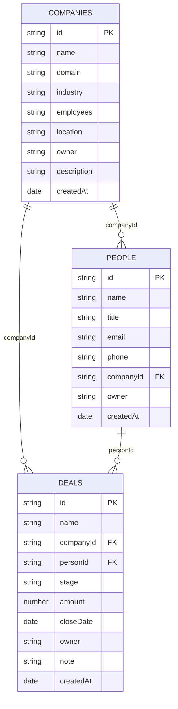

# 02 · 数据模型

> ⚠️ 本文档描述 **1.0 单机原型**（JSON 文件存储、无登录）。当前版本为 2.0 网络版，请优先阅读 [[06-网络版架构]] · [[07-权限与流转矩阵]] · [[08-部署与运维]]。


> 三个集合、字段定义、关系与约束。改字段前先读这份，能避免"表格改了但详情面板没改"这类不一致。
> 返回 [[README]] · 相关：[[01-设计思路]]

---

## 1. 整体结构

`data/db.json` 是一个对象，包含四个顶层键：

```json
{
  "meta":      { "workspace": "...", "me": "...", "team": [], "updatedAt": "..." },
  "companies": [],
  "people":    [],
  "deals":     []
}
```

服务端只校验 `companies` 必须是数组（一条最松的体检），其余结构由前端配置保证。

## 2. 关系



两条关联是"一对多"，用字符串字段保存对端 ID，**没有中间表**。这是刻意的：单机应用里关系只有这两种，用外键表只会让 JSON 和渲染代码复杂一倍。

## 3. 公司 companies

| 字段 | 类型 | 表格列 | 详情字段 | 说明 |
| --- | --- | --- | --- | --- |
| `id` | string | — | — | 主键，`c_` 前缀 |
| `name` | string | ✅ | ✅ | 记录标题 |
| `domain` | string | ✅ | ✅ | 只存域名，不带 `https://` |
| `industry` | enum | ✅ | ✅ | 见下方"行业" |
| `employees` | enum | ✅ | ✅ | 见下方"规模" |
| `location` | string | ✅ | ✅ | 城市 |
| `owner` | enum | ✅ | ✅ | 取自 `meta.team` |
| `description` | string | — | ✅ | 多行文本 |
| `createdAt` | date | ✅ | 只读展示 | `YYYY-MM-DD` |

## 4. 联系人 people

| 字段 | 类型 | 表格列 | 详情字段 | 说明 |
| --- | --- | --- | --- | --- |
| `id` | string | — | — | 主键，`p_` 前缀 |
| `name` | string | ✅ | ✅ | 记录标题 |
| `title` | string | ✅ | ✅ | 职位 |
| `email` | string | ✅ | ✅ | 纯文本展示，不做校验 |
| `phone` | string | ✅ | ✅ | 允许 `-` 分隔 |
| `companyId` | ref | ✅ | ✅ | → `companies.id` |
| `owner` | enum | ✅ | ✅ | 取自 `meta.team` |
| `createdAt` | date | ✅ | 只读展示 | |

联系人**只有一个公司**。现实中的"一人多司"未支持，因为会让表格列和筛选器复杂化。

## 5. 商机 deals

| 字段 | 类型 | 表格列 | 详情字段 | 说明 |
| --- | --- | --- | --- | --- |
| `id` | string | — | — | 主键，`d_` 前缀 |
| `name` | string | ✅ | ✅ | 记录标题 |
| `companyId` | ref | ✅ | ✅ | → `companies.id` |
| `personId` | ref | — | ✅ | → `people.id`，联动过滤 |
| `stage` | enum | ✅ | ✅ | 看板分组依据，见"阶段" |
| `amount` | number | ✅ | ✅ | 单位：元，可为 `null` |
| `closeDate` | date | ✅ | ✅ | 预计成交日 |
| `owner` | enum | ✅ | ✅ | 取自 `meta.team` |
| `note` | string | — | ✅ | 跟进备注 |
| `createdAt` | date | ✅ | 只读展示 | |

## 6. 枚举字典

**阶段 stage**（顺序即看板列顺序）

| 值 | 显示 | 颜色 |
| --- | --- | --- |
| `lead` | 线索 | `#8b8f98` |
| `qualified` | 需求确认 | `#4b7ef0` |
| `proposal` | 方案报价 | `#8a63e8` |
| `negotiation` | 商务谈判 | `#dd9426` |
| `won` | 赢单 | `#1a9e6c` |
| `lost` | 丢单 | `#c65a63` |

**行业 industry**：人工智能、数据服务、医疗健康、汽车出行、文化传媒、智能制造、零售电商、教育培训、金融科技、消费品牌、其他

**规模 employees**：1-20人、20-50人、50-200人、200-500人、500-1000人、1000人以上

以上三组都定义在 `public/app.js` 顶部。**增删枚举值只需改这里**，表格、筛选器、详情下拉会同步生效；但已有的旧值不会自动迁移，需要手工改 `db.json`。

## 7. meta

```json
{
  "workspace": "北辰科技",
  "me": "张远",
  "team": ["张远", "李梦", "王浩", "陈静"],
  "updatedAt": "2026-10-30T14:00:00.000Z"
}
```

| 键 | 用途 |
| --- | --- |
| `workspace` | 侧栏顶部工作区名，同时作为浏览器标题 |
| `me` | 当前用户，"我负责的"视图按它过滤，新建记录默认指派给它 |
| `team` | 负责人下拉的全部选项 |
| `updatedAt` | 服务端每次写入时自动更新时间戳，前端不用管 |

改 `me` 或 `team` 直接改 `db.json` 即可，刷新页面生效。

## 8. 完整性规则

这些规则**写在前端**（`app.js` 的 `deleteRecord` 与 `editRecordField`），服务端不做校验：

1. 删除公司 → 该公司名下联系人的 `companyId` 置空、商机的 `companyId` 置空（记录本身保留）；
2. 删除联系人 → 指向他的商机 `personId` 置空；
3. 商机换公司 → 若原 `personId` 所属公司不等于新公司，则清空 `personId`；
4. 商机的联系人下拉 → 只列出 `companyId` 相同的联系人；未选公司时列出全部。

第 3、4 条一起保证了不会出现"商机挂在 A 公司、关键联系人却在 B 公司"的脏数据。

## 9. 完整示例（截取一条）

```json
{
  "id": "d1",
  "name": "星环智能 · 企业版年度订阅",
  "companyId": "c1",
  "personId": "p1",
  "stage": "negotiation",
  "amount": 680000,
  "closeDate": "2026-11-15",
  "owner": "张远",
  "note": "技术评审已通过，卡在付款账期。",
  "createdAt": "2026-08-20"
}
```

## 10. 加一个对象要动哪里

以加"工单 tickets"为例，按顺序改 `public/app.js`：

1. `OBJECTS` 里加 `tickets: { key, label, noun, icon, titleKey, searchKeys, columns, fields }`；
2. 若要看板，加 `kanbanField: 'status'` 并在 `STAGES` 之外定义自己的分组枚举（当前 `boardHtml` 写死用 `STAGES`，需改成读配置）；
3. `index.html` 无需改；
4. 侧栏的 `keys` 数组加上 `'tickets'`（`renderSidebar` 内）；
5. `db.json` 里加 `"tickets": []`，并给 `server.js` 的校验放行（或把校验改成"任意集合"）。

服务端写入时不校验集合名，所以第 5 步只影响"空库初始化"。
