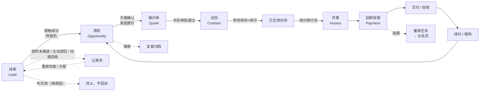
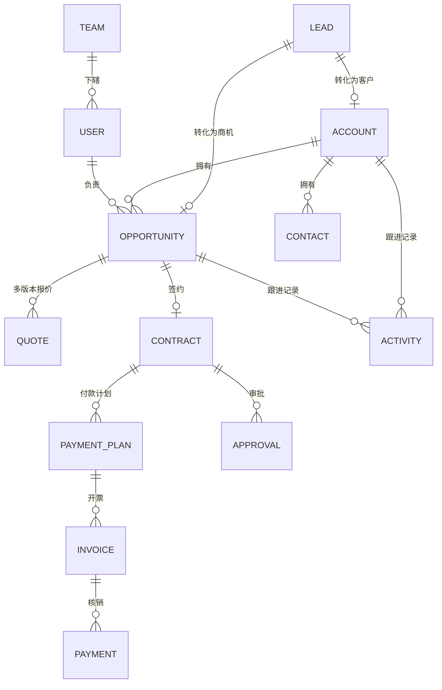

# 05 · CRM 全流程方案（线索 → 商机 → 合同 → 回款）

> 面向 B2B 项目型销售的完整 CRM 设计：线索、业务员、经理、财务四方如何在系统里流转、各自看到什么、卡点在哪、单据怎么走、指标怎么算。
> 返回 [[README]] · 前置阅读：[[01-设计思路]] · 数据基础：[[02-数据模型]]

---

## 0. 假设与边界

这份方案建立在以下假设上，**如有不符请先纠正这四条，后面的结论会变**：

| 假设 | 取值 | 影响 |
| --- | --- | --- |
| 业务形态 | B2B 项目型销售，非快消/零售 | 决定"商机 + 合同 + 回款"是核心，而不是"订单 + 库存" |
| 客单价 | 10 万 ~ 200 万，含账期 | 决定必须有折扣审批与应收管理 |
| 团队规模 | 销售 30~80 人，分 3~6 个团队 | 决定必须有"公海规则"和"团队数据隔离" |
| 现有系统 | 无正式 CRM，Excel + 微信群 + 口头汇报 | 决定第一优先级是"数据进系统"，不是"报表好看" |

**不在本期范围**：进销存、生产工单、客服工单、营销自动化（EDM/自动化培育）、呼叫中心话术质检。这些属于相邻系统，通过接口对接即可，不要塞进 CRM。

---

## 1. 要解决什么

### 1.1 六个真实痛点

| # | 痛点 | 现象 | 本质 |
| --- | --- | --- | --- |
| 1 | 线索来了没人管 | 展会名单躺 Excel，两周后没人记得跟进过 | 缺"分配 + 超时回收"机制 |
| 2 | 撞单、抢单 | 两个业务员跟同一个客户，报价不一致 | 缺客户查重与归属规则 |
| 3 | 过程不可见 | 经理只能问"这单怎么样了"，得到"快了" | 缺阶段推进条件（无证据不能进下一阶段） |
| 4 | 折扣失控 | 业务员口头承诺 7 折，财务签合同时才发现 | 缺折扣审批前置 |
| 5 | 合同与回款脱节 | 合同签了 80 万，年底一算只回 45 万 | 缺回款计划、开票与核销 |
| 6 | 数据不可信 | 三个报表三个数，没人敢用 | 缺单一数据源与"三单匹配"校验 |

### 1.2 目标（可量化）

| 指标 | 现状（假设） | 上线 6 个月目标 |
| --- | --- | --- |
| 线索 24 小时首触率 | 40% | ≥ 85% |
| 线索 → 商机转化率 | 15% | ≥ 25% |
| 商机赢单率 | 18% | ≥ 25% |
| 平均成交周期 | 95 天 | ≤ 75 天 |
| 合同额 → 回款额（当年度） | 65% | ≥ 85% |
| DSO（应收账款周转天数） | 90 天 | ≤ 60 天 |
| 周报准备时间 | 半天 | 0（看板自动） |

北极星指标只有一个：**现金回款额**。其余都是过程指标，用来解释它为什么涨或跌。

---

## 2. 组织与角色

### 2.1 六个角色

| 角色 | 核心职责 | 系统内主要动作 | 考核指标 |
| --- | --- | --- | --- |
| **线索专员（SDR）** | 名单清洗、首触、预约 | 录入/导入线索、打标签、打电话、转商机或判无效 | 有效线索数、首触时长、转商机数 |
| **业务员（AE）** | 推进商机、报价、签约 | 建商机、写跟进、做报价、提合同、催回款 | 签约额、回款额、赢单率 |
| **销售经理** | 分配、辅导、审批、预测 | 分配线索、审批折扣、复盘商机、看团队看板 | 团队达成率、预测准确率 |
| **销售总监 / VP** | 区域目标、大单策略 | 审批大额折扣与非标合同、看全局 | 区域营收、结构健康度 |
| **财务** | 合同审核、开票、回款核销、应收管理 | 审合同条款、开票、登记回款、对账 | 回款率、DSO、坏账率 |
| **管理员** | 配置对象/字段/流程/权限 | 配审批阈值、公海规则、字段权限 | 系统使用率、数据完整度 |

> 关键设计：**SDR 与 AE 分离**。线索归属与商机归属是两条线，SDR 的产出（转商机）要能被单独计量，否则没人愿意做"拓客"这种脏活。若团队小，可一人兼两角，但系统里必须是两个动作。

### 2.2 功能权限矩阵

`✓` 全量 · `△` 仅本人/本团队 · `✗` 不可见

| 功能 | SDR | 业务员 | 经理 | 总监 | 财务 | 管理员 |
| --- | --- | --- | --- | --- | --- | --- |
| 线索：新建/导入 | ✓ | ✓ | ✓ | ✓ | ✗ | ✓ |
| 线索：查看 | △ 本人 + 公海 | △ 本人 | △ 本团队 | ✓ | ✗ | ✓ |
| 线索：分配/回收 | ✗ | ✗ | ✓ | ✓ | ✗ | ✓ |
| 商机：新建/编辑 | ✗ | △ 本人 | △ 本团队 | ✓ | 只读 | ✓ |
| 商机：阶段推进 | ✗ | △ 本人 | ✓ | ✓ | ✗ | ✓ |
| 报价：创建 | ✗ | △ 本人 | ✓ | ✓ | 只读 | ✓ |
| 折扣审批 | ✗ | ✗ | ≤5% | ≤10% | ✗ | 配置 |
| 合同：提交 | ✗ | △ 本人 | ✓ | ✓ | ✗ | ✓ |
| 合同：财务审核 | ✗ | ✗ | ✗ | ✗ | ✓ | ✗ |
| 开票 / 回款登记 | ✗ | 只读本人 | 只读团队 | 只读 | ✓ | ✗ |
| 报表：个人 | ✓ | ✓ | ✓ | ✓ | ✓ | ✓ |
| 报表：团队 / 全局 | ✗ | ✗ | 团队 | ✓ | ✓ | ✓ |
| 字段：底价 / 成本 / 毛利 | ✗ | ✗ | ✓ | ✓ | ✓ | ✓ |
| 系统配置 / 审计日志 | ✗ | ✗ | ✗ | ✗ | ✗ | ✓ |

**字段级权限**是这张表里最容易漏的一行：业务员可以看"报价金额"，但**不能看底价、成本、毛利率**；否则等于把谈判底牌发给了对手公司。

---

## 3. 端到端流程

主链路：**线索 → 商机 → 报价 → 合同 → 开票 → 回款 → 交付/续约**。每一环都有"进不去下一环的硬条件"，这是整套方案的骨架。



### 3.1 环节一：线索获取与分配

| 项 | 内容 |
| --- | --- |
| 触发 | 展会名单导入 / 官网表单 / 电话咨询 / 渠道推荐 / 老客户转介绍 |
| 关键动作 | 查重 → 打标签（来源、行业、规模、意向度）→ 分配 → 24h 内首触 → 记录结果 |
| 输出 | 线索记录 + 首个跟进活动 |
| 卡点 | **查重命中已有客户 → 不允许新建，转为"加入该客户跟进攻略"**；否则必然出现撞单 |
| 超时规则 | **双时钟（已实现，见 `docs/20`）**：领取后 24h 无触达 → 提醒；72h 仍无任何跟进 → 回公海；过 7 天保护期后 30 天无有效跟进（`call/visit/email/meeting/wechat`，`note` 不续）→ 回公海；判无效则终止、不回池 |

**线索状态机**：`新建 → 待分配 → 跟进中 → 已转商机 / 已判无效 / 已回收`

判无效必须选原因（无预算、无需求、联系不上、竞品已签、非目标客户），否则"无效"会变成业务员的垃圾桶，线索转化率永远失真。

### 3.2 环节二：线索转商机（交接点 1）

这是第一个跨角色交接，也是数据质量的分水岭。

**转商机的硬条件（缺一不可）**：

1. 已确认关键联系人（姓名 + 职位 + 联系方式）；
2. 有明确需求描述（一句话说清客户要解决什么）；
3. 有预算区间或采购计划时间；
4. 有下一步动作和日期。

四条填不全，系统不允许转。这不是形式主义——漏掉任何一条，这个商机最后大概率躺在"方案报价"阶段烂掉。

**归属规则**：线索转商机后，商机归属 AE；SDR 保留"线索来源"记录用于计佣。若 SDR 与 AE 是同一人，两个字段都记他。

### 3.3 环节三：商机推进（核心）

七个阶段，每阶段有**进入条件和必填证据**：

| 阶段 | 赢率 | 进入条件（必须有） | 常见失败原因 |
| --- | --- | --- | --- |
| 1 初步接洽 | 10% | 联系人 + 需求初判 | 只有一个前台电话 |
| 2 需求确认 | 25% | 需求文档/会议纪要 + 预算区间 + 决策链 | 只见了执行层，没见决策人 |
| 3 方案报价 | 45% | 方案已交付 + 报价单已发 | 报价发了不跟进，客户拿去比价 |
| 4 商务谈判 | 65% | 进入商务环节 + 明确竞争对手 + 谈判要点 | 没有议价筹码，只能降价 |
| 5 合同审批 | 80% | 合同草稿 + 条款确认 | 法务/财务卡条款，来回两周 |
| 6 赢单 | 100% | 合同生效 + 首款到账条件满足 | 签了不收钱 |
| 7 输单 | 0% | 输单原因 + 竞争对手 + 复盘结论 | 只写"客户不做了" |

> **赢单判定必须绑定"合同已生效"，不是"客户说定了"。** 这条规则能消掉一半的虚假乐观预测。

**阶段回退**也是允许的（谈判回退到方案），但必须填原因，且计入"阶段反复次数"——这是商机健康度的领先指标。

### 3.4 环节四：报价与折扣审批（交接点 2）

报价单是**独立单据**，不是商机上的一个数字。原因：

- 一个商机可以有多版报价（V1/V2/V3），版本要留痕；
- 折扣审批要挂在具体版本上；
- 合同金额必须能追溯到某一版报价，否则财务无法核对"合同为什么比报价低了 8 万"。

**折扣审批阈值（可按金额叠加）**：

| 折扣幅度 | 审批人 | 时效 |
| --- | --- | --- |
| 0%（按标准价成交） | **免审批**，直接进入合同 | — |
| ≤ 5% | 销售经理 | 4h |
| 5% ~ 10% | 销售总监 | 8h |
| > 10% | 总经理 | 24h |
| 任意折扣 + 合同额 > 100 万 | 追加总经理 | — |
| 账期 > 60 天 | 追加财务总监 | — |

审批未通过，报价单状态为"草稿"，不能生成合同。**未让价（折扣率 0）的报价提交即通过**，价格不再占用审批资源，审批资源集中到"让价"与合同条款上。

### 3.5 环节五：合同审批与归档（交接点 3）

合同是**法律与财务的分界**，必须串行过三关：

| 顺序 | 审核方 | 看什么 | 不通过会怎样 |
| --- | --- | --- | --- |
| 1 | 销售经理 | 金额、折扣、交付范围与报价一致 | 退回业务员 |
| 2 | 财务 | 开票信息、税率、账期、付款计划合理性 | 退回，附修改意见 |
| 3 | 法务（模板外条款才触发） | 违约条款、知识产权、验收标准 | 退回，可能需谈判 |

通过后进入"用印 → 归档 → 生效"。**生效后合同锁定**：金额、账期、付款计划不可再改，要改只能走"合同变更单"并留版本。

**合同必填**：合同编号、客户、关联商机、金额（含税/不含税）、税率、账期、付款计划（分期节点 + 金额 + 日期）、开票信息、签约日期、生效日期、到期日期。

### 3.6 环节六：开票与回款（交接点 4）

这是财务真正介入的地方，也是 CRM 最容易做残的地方。

- **付款计划在合同生效时自动生成**，不是财务手工排。例：30% 预付 / 60% 验收 / 10% 质保。
- **开票申请**由业务员发起（关联某期付款计划），财务审核后开票，回填发票号与开票日期。
- **回款登记**由财务录入（到账日、金额、银行流水号），支持**一笔回款核销多张发票**，也支持**一张发票分多次回款**。
- **逾期自动生成催收任务**派给合同归属业务员，逾期 30/60/90 天升级提醒至经理/总监。

**三单匹配**（这是财务愿意用这套系统的唯一理由）：

```
合同金额  =  Σ 开票金额  =  Σ 回款金额 + 应收余额
```

任一处对不上，报表标红并列出差异明细。没有这条校验，CRM 里的财务数据永远只能当参考。

### 3.7 环节七：交付、验收与续约

交付不是 CRM 的主业，但有三件事必须落在 CRM 里：

1. **验收节点**：验收单日期直接决定"验收款"能否开票，必须回填；
2. **客户健康度**：交付延期、工单激增、关键联系人离职 → 续约风险信号；
3. **续约/增购**：合同到期前 90 天自动创建"续约商机"，指派原 AE。

---

## 4. 单据与状态机

| 单据 | 状态流 | 谁能推进 |
| --- | --- | --- |
| 线索 Lead | 新建 → 待分配 → 跟进中 → 已转商机 / 已判无效 / 已回收 | SDR、经理 |
| 商机 Opportunity | 初步接洽 → 需求确认 → 方案报价 → 商务谈判 → 合同审批 → 赢单 / 输单 | AE、经理 |
| 报价单 Quote | 草稿 → 审批中 → 已通过 / 已驳回 → 已失效（被新版本替代） | AE 提交，经理/总监审批 |
| 合同 Contract | 草稿 → 审批中 → 待用印 → 已生效 → 已归档 / 已作废 | AE 提交，财务/法务审核 |
| 发票 Invoice | 待开票 → 已开票 → 已红冲 | 财务 |
| 回款 Payment | 待核销 → 已核销（部分/全额） | 财务 |
| 审批单 Approval | 待处理 → 已通过 / 已驳回 / 已撤回 / 已超时 | 各审批人 |

**通用规则**：所有状态变更写审计日志（谁、何时、从什么状态到什么状态、附言）；驳回必须填原因；已生效单据不可删除，只能作废。

---

## 5. 数据模型



**核心实体**

| 实体 | 关键字段 |
| --- | --- |
| `account` 客户 | 名称、统一社会信用代码、行业、规模、区域、归属团队、负责人、客户等级（A/B/C）、来源、首签日期 |
| `contact` 联系人 | 姓名、职位、角色（决策人/影响者/使用者/阻碍者）、手机、邮箱、是否关键人 |
| `lead` 线索 | 来源、渠道明细、意向产品、意向度、清洗结果、分配对象、首触时间、无效原因 |
| `opportunity` 商机 | 名称、客户、金额、阶段、赢率、预计成交日、竞争对手、决策链、下一步动作 + 日期、归属 |
| `quote` 报价单 | 版本号、明细行（产品/数量/单价/折扣）、总额、折扣率、毛利率、审批状态 |
| `contract` 合同 | 编号、金额、税率、账期、付款计划、签约/生效/到期日、用印状态、归档路径 |
| `payment_plan` 付款计划 | 期次、比例、金额、计划日期、条件（预付/验收/质保） |
| `invoice` 发票 | 发票号、金额、税率、开票日期、关联付款计划 |
| `payment` 回款 | 到账日、金额、银行流水号、核销明细 |
| `activity` 跟进 | 类型（电话/拜访/邮件/会议/微信）、对象、时间、摘要、下一步 |
| `approval` 审批 | 业务类型、业务ID、节点、审批人、结果、意见、时效 |
| `user` / `team` | 姓名、角色、所属团队、上级、数据范围 |

**三条建模原则**

1. **线索与商机分离**：线索是"未验证的机会"，商机是"已验证的机会"，混在一张表里，转化率就无法计算；
2. **金额只信合同**：商机金额是"预估"，合同金额是"事实"，报表一律以合同为准，商机金额只用于预测；
3. **一切跟进皆活动**：电话、拜访、微信、邮件都落到 `activity`，否则"过程管理"是空话。

---

## 6. 权限与数据可见性

四层叠加，任何一层不满足即拒绝：

```
功能权限（能不能点） → 数据范围（能看到谁的数据） → 字段权限（能看到哪个格子） → 操作权限（能不能改/删/审批）
```

**数据范围四档**：本人 → 本团队 → 本部门 → 全部。
**共享机制**：商机可加"协作人"（售前、交付），协作人获得只读 + 写跟进权限，但不计入业绩。
**公海规则（一期已实现；下列默认值可在「系统设置 → 公共池规则」调整，改完即时生效）**：

| 规则 | 默认值 | 说明 |
| --- | --- | --- |
| 启用线索公海 | 开 | 关掉后领取 / 放回 / 自动回收接口停用，已有数据保留 |
| 首触提醒 | 24h | 无触达只提醒，不回收 |
| 首触回池 | 72h | 完全没有任何跟进即回池，**不受保护期屏蔽**（见 `docs/20` v4 第 1 条） |
| 跟进回池 | 30 天 | 过保护期后无有效跟进回池；`note` 不续时钟 |
| 保护期 | 7 天 | 只屏蔽 30 天跟进时钟与提醒，不屏蔽首触时钟 |
| 单人在库上限 | 50 条 | 超出不能再领 |
| 每周领取上限 | 10 条 | 按 `pool_events(action='claim')` 计，UTC 周一起算 |
| 回收通知 | 提前 3 天 | 站内 `activities(type='note')` 提醒，20h 内去重；邮件/短信/企微列 P2 |
| 自动回收 | 开 | janitor 每小时一次，启动 20 秒后先跑一次 |

> `status='invalid'` / `converted` 的线索**永不回池**；早期文档把「判无效」也画成回公海，已按 `docs/20` 修正。
> 池状态与业务状态机正交：`owner_id IS NULL` 即在池中，不新增「池状态」，不改 `new/contacted/qualified/converted/invalid`。
> 外部线索 API 未指定负责人时也默认入公海，由组织内成员领取。

公海不是惩罚机制，是**线索再分配机制**。设计不好会变成"业务员屯线索"，比没有公海更糟。

---

## 7. 审批流设计

统一审批引擎，业务方只配"节点 + 条件 + 审批人角色"，不写代码。

```
提交 → [条件分支] → 直属经理 → [金额/折扣触发] → 总监 → [非标触发] → 法务
     → 财务 → 结束
```

| 能力 | 说明 |
| --- | --- |
| 条件分支 | 按折扣率、合同额、账期、客户等级、是否非标条款动态路由 |
| 加签 / 转交 | 审批人可加签上级或转交同角色 |
| 超时升级 | 超时自动提醒 + 升级至上一级 |
| 撤回 | 未处理的节点可撤回 |
| 留痕 | 每个节点的意见、时间、耗时全部留档，可算"平均审批时长" |

**审批时长是流程健康度指标**：如果一份合同平均审批 6 天，销售就会绕过系统先签后补，系统就废了。

---

## 8. 报表与看板

按角色给不同首页，不要给所有人同一张报表。

| 角色 | 首页看板 |
| --- | --- |
| SDR | 今日待跟进、超时未跟进、本周转商机数、线索来源分布 |
| 业务员 | 我的漏斗、本月签约/回款进度、待办（跟进/审批/催收）、逾期商机 |
| 经理 | 团队漏斗、成员排名、预测 vs 目标、折扣使用情况、公海健康度 |
| 总监 | 区域营收、团队对比、大单进展、赢单率趋势、竞争对手胜败分析 |
| 财务 | 应收账龄、逾期 TOP10、开票待办、三单匹配差异、回款日历 |

**核心报表**

1. **线索漏斗**：曝光 → 线索 → 有效线索 → 商机 → 赢单，逐层转化率 + 各来源 ROI；
2. **加权预测**：`Σ(商机金额 × 阶段赢率) × 收敛系数`，与实际签约对比算"预测准确率"；
3. **赢单/输单分析**：按竞争对手、行业、金额区间、销售周期分组；
4. **应收账款账龄**：0-30 / 31-60 / 61-90 / 90+ 天，按客户与业务员双维度；
5. **人效**：人均签约额、人均回款、平均单产、跟进次数与转化的相关性。

---

## 9. 功能清单（按优先级）

### P0 · 让数据进系统（4~6 周）

客户、联系人、线索（含导入、查重、分配）、商机（7 阶段 + 推进条件）、跟进活动、任务待办、基础角色权限、个人与团队漏斗、审计日志。

### P1 · 让钱能对上（4~5 周）

报价单与多版本、折扣审批、合同审批与归档、付款计划、开票申请、回款登记与核销、三单匹配校验、应收账龄。

### P2 · 让管理有效（3~4 周）

公海规则（**已提前到一期实现**，见 `docs/20`）、目标与预测、团队排名、字段级权限、移动端（企微/钉钉内嵌）、消息通知（审批/超时/催收）、导入导出。

### P3 · 让系统延伸（持续）

交付与验收节点、续约提醒、客户健康度评分、开放 API、与 ERP/开票系统对接、BI 自助分析。

---

## 10. 技术架构

```
┌───────────────────────────────────────────────┐
│ 前端：Vue3 / React + 表格虚拟滚动 + 看板        │
│ 内嵌企微/钉钉 H5，同一套代码                    │
└──────────────────┬────────────────────────────┘
                   │ REST / JSON
┌──────────────────▼────────────────────────────┐
│ 应用层：Node(Nest) 或 Java(Spring Boot)        │
│  ├─ 元数据服务：对象/字段/视图/布局 全部配置化    │
│  ├─ 权限服务：RBAC + 数据范围 + 字段级           │
│  ├─ 工作流引擎：状态机 + 审批流（配置驱动）      │
│  ├─ 业务服务：线索/商机/合同/财务               │
│  └─ 审计与通知                                  │
└──────────────────┬────────────────────────────┘
                   │
┌──────────────────▼────────────────────────────┐
│ PostgreSQL（主库） + Redis（缓存/锁）           │
│ 对象存储：合同扫描件、附件                       │
└───────────────────────────────────────────────┘
```

**三个必须做对的技术决策**

1. **元数据驱动**：对象、字段、视图、审批阈值全部配置化。否则"加一个字段"要发版，业务方三个月就会弃用系统。
2. **权限在服务端**：前端隐藏按钮只是体验，数据范围过滤必须在 SQL 层加 `WHERE` 条件，否则改个接口就能看到全公司数据。
3. **状态机在服务端**：所有状态流转校验必须服务端执行，前端只负责展示允许的动作。

**为什么不用现成的开源 CRM 改**：SuiteCRM / EspoCRM 的对象模型是"联系人+商机"时代的设计，财务单据（付款计划、开票、核销、三单匹配）基本没有，硬改的工作量大于重写，且技术栈老旧（PHP + 复杂插件体系）。

---

## 11. 实施计划

| 阶段 | 周期 | 交付物 | 验收标准 |
| --- | --- | --- | --- |
| 0 调研与配置 | 1 周 | 角色清单、字段字典、流程图、审批阈值表 | 业务方签字确认流程与阈值 |
| 1 P0 上线 | 4~6 周 | 线索→商机全链路 + 权限 + 漏斗 | 销售全员真实录入，线索 24h 首触率 ≥ 80% |
| 2 P1 上线 | 4~5 周 | 报价/合同/开票/回款 | 财务能用系统出应收账龄表，三单匹配无差异 |
| 3 P2 上线 | 3~4 周 | ~~公海~~（已提前到一期实现）、预测、移动端 | 经理周会直接看系统，不再要 Excel |
| 4 迭代 | 持续 | 交付/续约/API | 续约提醒自动触发 |

**上线策略（决定成败）**

1. **先跑通一条线，不要全员铺开**：选 1 个团队、1 个区域试点 3 周，跑通"线索→合同"；
2. **历史数据只导客户与在跟商机**，历史跟进记录不导（脏数据会毁掉第一印象）；
3. **系统外不允许存在第二份数据**：Excel 台账当天废止，否则两套数据必然打架；
4. **经理是第一责任人**：经理不用，业务员一定不用。周会只看系统看板。

---

## 12. 与现有单机版（MSERM）的关系

当前 `D:\wwwroot\MSERM` 是一套**单机原型**：零依赖、JSON 存储、无登录、只有公司/联系人/商机三类对象。它的价值是**把交互形态和视觉语言定下来了**（表格、看板、抽屉、筛选），可以直接复用。

演进有两条路：

| 方案 | 做法 | 优点 | 代价 |
| --- | --- | --- | --- |
| **A 渐进演进** | 保留现有 UI，替换数据层：JSON → PostgreSQL，加登录与权限，按 P0/P1 逐个加模块 | 已经能看到的界面不用重做，节奏可控 | 现有 `app.js` 是"全量渲染 + 全量读写"，改造成本会随模块增加而指数上升 |
| **B 重写主干** | 保留视觉规范与交互范式，用元数据驱动重写前后端 | 一次做对，P1/P2 加模块几乎零成本 | 前期 4~6 周看不到界面，需要业务方耐心 |

**建议：B。** 理由：现有代码只有约 1200 行，是一次性投入；而"权限、审批、财务单据"这三件事都无法在"整库读写"的模型上生长——权限要求字段级过滤，审批要求状态机，财务要求事务与三单匹配，都需要真正的数据库与服务端校验。硬改 A 会在 P1 阶段推倒重来。

**可复用的资产**：`styles.css` 的整套设计变量与组件样式、`OBJECTS` 的配置结构（直接演进成元数据定义）、看板/表格/抽屉的交互范式、[[02-数据模型]] 的字段字典。

---

## 13. 风险与应对

| 风险 | 概率 | 影响 | 应对 |
| --- | --- | --- | --- |
| 业务员抵触，数据不录 | 高 | 系统空转 | 录入即提成依据；经理周会只看系统；前 4 周设"数据完整度"奖惩 |
| 流程设计过重，审批太慢 | 中 | 绕过系统 | 审批阈值分档、超时自动升级、每周统计审批时长并优化 |
| 财务模块与现有开票系统冲突 | 中 | 重复录入 | P1 先做单向同步（CRM 推送开票申请），不做双向 |
| 历史数据脏 | 高 | 报表不可信 | 只导客户主数据与在跟商机，强制必填字段，导入后跑一轮查重合并 |
| 需求蔓延 | 高 | 延期 | 以本文档 P0/P1/P2 为合同边界，新需求进 P3 池 |
| 权限设计过细导致运维负担 | 中 | 管理员崩溃 | 角色控制在 6 个以内，数据范围只做 4 档，不做逐人配置 |

---

## 14. 一页纸结论

- **谁用**：SDR 拓客、AE 打单、经理管过程与审批、财务管钱，四个角色一条链路。
- **靠什么串起来**：4 个交接点（线索转商机 / 报价审批 / 合同审批 / 开票回款），每个都有硬条件。
- **数据可信靠什么**：阶段推进必须带证据 + 赢单绑定合同生效 + 三单匹配校验。
- **先做什么**：P0 六周，把线索到商机的链路跑通，让数据先真实地进系统。
- **技术上必须做对的**：元数据驱动、权限在服务端、状态机在服务端。
- **成败关键**：不是功能多少，而是**经理是否真的用系统开会**。
