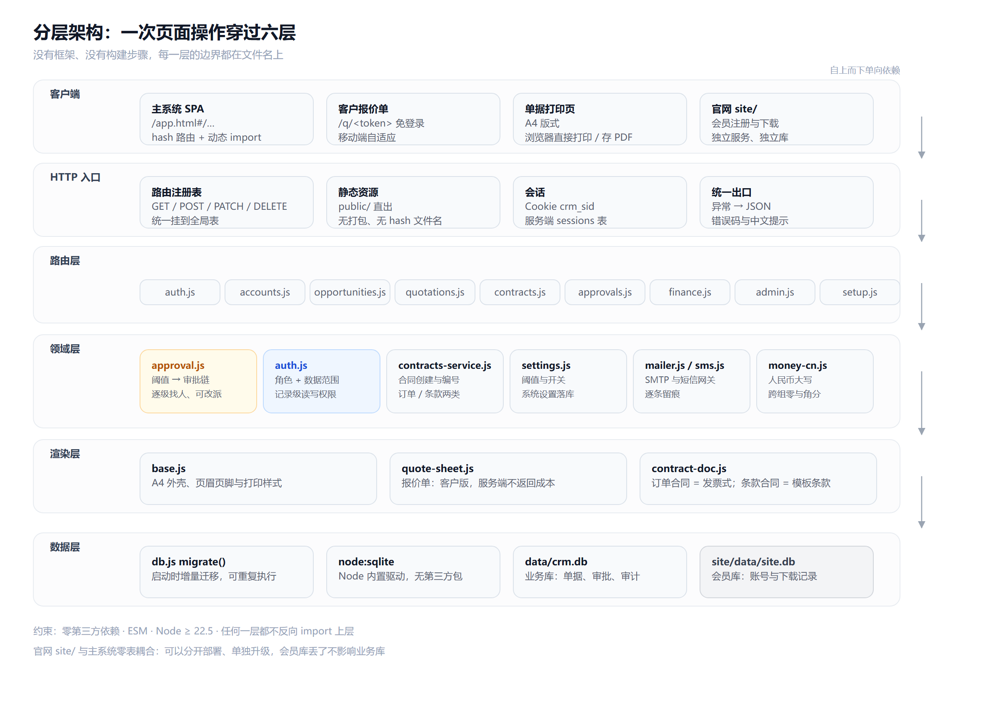
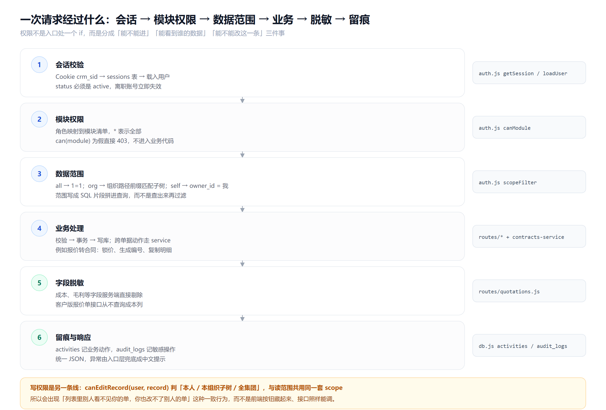
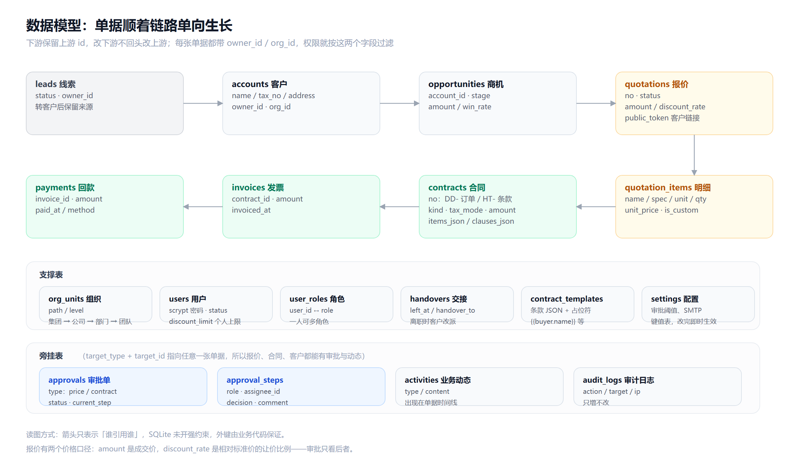
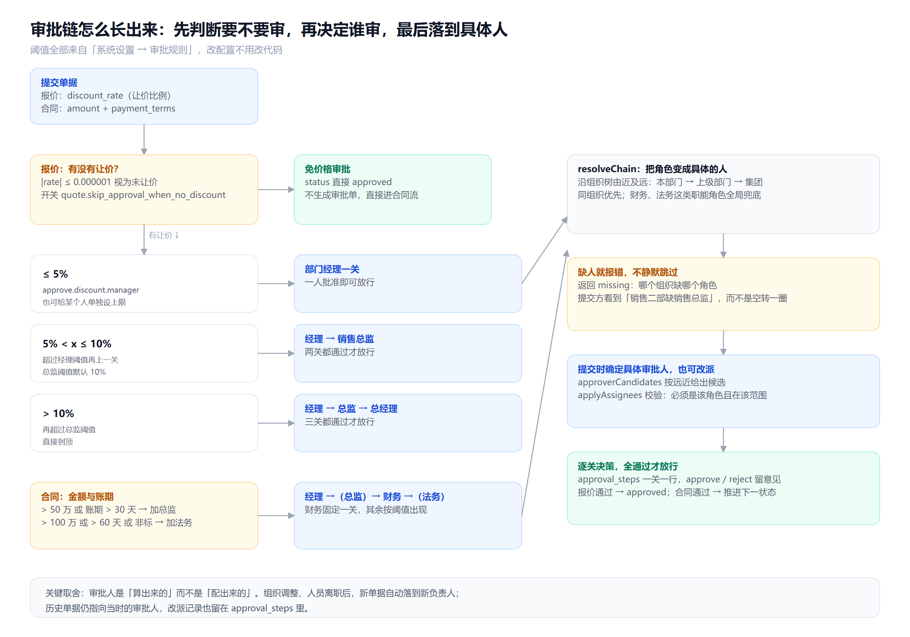

# 架构与开发逻辑

这份文档回答三个问题：**代码是怎么分层的**、**一次操作按什么顺序穿过这些层**、**业务规则（尤其是审批与权限）落在哪个文件里**。

看图为主，配少量代码位置。所有结论都能在仓库里对应到具体文件。

---

## 一、为什么是这个形状

| 选择 | 原因 | 代价 |
|---|---|---|
| Node 内置 `node:sqlite` | 单文件数据库，随项目走；备份就是复制一个文件 | 不支持多机写；超过约几十个并发写要换库 |
| 原生 `http` + 自研路由表 | 没有框架版本升级、中间件黑盒 | 路由、鉴权、错误处理都要自己写清楚 |
| 零第三方依赖 | 交付物就是源码，`git clone && npm start` 能跑 | 图片处理、PDF 这类能力只能绕开或手写 |
| 单据用 HTML + `@page` | 浏览器直接打印/另存 PDF，版式用 CSS 就能精确控制 | 要生成服务端 PDF 的场景需另加 puppeteer |
| 前端 hash 路由 + 动态 `import()` | 无需打包，改完刷新即生效 | 没有 tree-shaking，首屏按需加载要自己维护 |
| 数据范围写成 SQL 片段 | 一个函数收口，列表与详情行为一致 | 复杂联表要手动带上 `scopeFilter` |

一句话：**用最少的外部依赖，换最大的可读性**。代价是有些事要自己写，收益是任何一行代码都能追溯到文件和函数。

---

## 二、六层与依赖方向



依赖只朝下，任何一层都不反向 `import` 上层。

| 层 | 位置 | 职责 | 不该做的事 |
|---|---|---|---|
| 客户端 | `public/` | 渲染与交互，hash 路由切换视图 | 不做权限判断（只做按钮显隐），不拼 SQL |
| HTTP 入口 | `server.js`、`src/http.js` | 路由注册、静态资源、Cookie 解析、错误兜底 | 不写业务规则 |
| 路由层 | `src/routes/*.js` | 参数校验、调用领域逻辑、组装响应 | 不直接写跨单据的复杂事务 |
| 领域层 | `src/*.js` | 审批链、权限、合同创建、邮件短信、金额大写 | 不关心 HTTP 状态码 |
| 渲染层 | `src/doc/*.js` | A4 单据 HTML | 不查库（数据由路由层查好传入） |
| 数据层 | `src/db.js`、`data/crm.db` | 连接、建表、增量迁移 | 不放业务判断 |

路由文件与模块一一对应：`auth` `accounts` `leads` `opportunities` `products` `quotations` `contracts` `approvals` `finance` `dashboard` `reports` `admin` `attachments` `setup`。

---

## 三、一次请求的生命周期



权限被拆成三个独立问题，对应三个函数：

| 问题 | 函数 | 失败表现 |
|---|---|---|
| 这个角色能不能进这个模块？ | `canModule(user, module)` | 403，不进入业务代码 |
| 能看到谁的数据？ | `scopeFilter(user, {owner, org})` | 查询条件变窄，看不到就是查不到 |
| 能不能改这一条？ | `canEditRecord(user, rec)` | 403，且与读范围用同一套 `scope` |

`scope` 的三种取值直接变成 SQL 片段：

```js
// src/auth.js
all  → { sql: '1=1', params: [] }
org  → { sql: "org_id IN (SELECT id FROM org_units WHERE path LIKE ?)", params: [`${user.orgPath}%`] }
self → { sql: 'owner_id = ?', params: [user.id] }
```

所以列表、详情、导出、统计用的是同一个谓词，不会出现「列表里看不见、详情能猜到 id 打开」这种漏洞。

**脱敏发生在服务端**：成本、毛利这些字段在 SQL 里就不 `select`，对无权限角色直接不存在，而不是前端 `display:none`。

---

## 四、数据模型



### 单据链路

```
线索 → 客户 → 商机 → 报价（+ 明细）→ 合同 → 发票 → 回款
```

下游只保留上游 `id`，**改下游不回头改上游**。报价转合同后，报价状态变 `converted`，但金额、折扣、明细都冻结在合同里（`items_json`），之后改报价不影响已签合同。

### 两类表

- **支撑表**：组织树、用户、角色、交接、合同模板、系统设置。它们定义「谁、在哪个组织、按什么规则」。
- **旁挂表**：`approvals` / `approval_steps` / `activities` / `audit_logs`。全部用 `target_type + target_id` 指向任意单据，所以报价、合同、客户都能挂审批和时间线，不需要为每类单据各建一套审批表。

### 两个价格口径（最容易混）

| 字段 | 含义 | 谁在用 |
|---|---|---|
| `amount` | 成交价（明细合计 - 让价） | 合同金额、开票、回款 |
| `discount_rate` | 相对标准价的让价比例 | **审批只看这个** |

`discount_rate` 为 0（含 `0.000001` 的浮点容差）意味着没有让价，价格审批整条链都不生成。

---

## 五、审批链是怎么长出来的



拆成两个函数，是这套系统最重要的一处设计：

```js
priceApprovalRequired(rate)        // 要不要审
chainForDiscount(rate, orgId)      // 谁来审（角色序列）
chainForContract({amount, paymentTerms, nonStandard})
```

以前把这两件事写在一起，结果是 0% 折扣也会生成一张「经理审批」空单，审批人点通过才算完 —— 这在真实使用里非常烦人。

### 阈值（都在系统设置里，改配置不用改代码）

| 键 | 默认 | 含义 |
|---|---|---|
| `approve.discount.manager` | 5（%） | ≤ 该值只需经理 |
| `approve.discount.director` | 10（%） | 超过再加总监 |
| `approve.discount.gm` | 100（%） | 超过总监阈值后到总经理 |
| `approve.contract.amount_director` | 500000 | 元，超过加总监 |
| `approve.contract.terms_director` | 30 | 天，超过加总监 |
| `approve.contract.amount_legal` | 1000000 | 元，超过加法务 |
| `approve.contract.terms_legal` | 60 | 天，超过加法务 |
| `quote.skip_approval_when_no_discount` | 1 | 未让价免价格审批 |

单个用户可以在用户管理里设 `discount_limit`，覆盖角色默认阈值 —— 老销售能自己批 8%，新人只能批 3%。

### 找人与改派

`resolveChain()` 沿组织树由近及远找对应角色：本部门 → 上级部门 → 集团。找不到就返回 `missing`，接口直接 400 并说明「哪个组织缺哪个角色」，**不静默跳过**。

提交时 `approverCandidates()` 给出候选（同组织优先），`applyAssignees()` 校验改派对象必须是该角色且在该范围内。

合同审批链固定含财务；金额 > 100 万、账期 > 60 天或非标条款时追加法务。

---

## 六、单据为什么是 HTML

`src/doc/base.js` 提供 A4 外壳、页眉页脚与打印样式，`quote-sheet.js` 与 `contract-doc.js` 只负责内容。

- 浏览器 `Ctrl+P` 直接打印或「另存为 PDF」，不需要服务端 PDF 库
- 客户版报价单走 `/q/<token>`：免登录、移动端自适应、**服务端不查成本列**
- 订单合同按中国发票版式（购买方/销售方、明细含税率税额、价税合计 + 人民币大写）；条款合同按模板填充 `{{buyer.name}}` `{{amount}}` `{{contract_no}}` 等占位符

人民币大写单独抽成 `src/money-cn.js`，处理了跨组零与角分的坑（`100000` → 壹拾万元整，`100100` → 壹拾万零壹佰元整）。

---

## 七、前端怎么组织

```
public/
├── app.html            # 单页外壳
├── js/
│   ├── app.js          # hash 路由、导航、顶栏、登录态
│   ├── api.js          # fetch 封装（统一错误提示）
│   ├── ui.js           # modal / toast / 表格等基础件（弹窗支持多层叠加）
│   ├── store.js        # 登录用户与字典缓存
│   ├── approval-flow.js# 提交审批：审批人确认 + 改派
│   ├── contract-create.js # 订单合同 / 条款合同表单
│   ├── quote-editor.js # 报价编辑器（含例外商品弹窗）
│   └── views/*.js      # 一个模块一个文件，导出 render(el, route, ctx)
└── css/
```

路由约定 `#/模块/单据id`，例如 `#/quotations/11`。视图通过 `import()` 按需加载，改完刷新即生效，没有构建步骤。

`ui.js` 的弹窗按层叠加：每层独立 `.overlay` 追加到 `#modal`，Esc 只关最上层。这一条是被「报价里加例外商品把编辑器搞没了」的真实 bug 逼出来的。

---

## 八、官网与主系统的边界

```
主系统 (8081) ── data/crm.db      业务数据，绝不外传
官网   (8099) ── 独立项目，自己的会员库与下载记录；通过 SITE_DEMO_URL 链到 /demo
```

两者**零表耦合**，可以分开部署、单独升级：

- 官网管注册、登录、验证码、每日下载配额、安装包分发、运营后台
- 主系统完全不知道官网存在，也不向官网发任何数据
- 唯一联系是官网下载的 `.db` 文件被手工放进 `data/` 目录

这样即使官网被拖库，业务数据也不受影响。

---

## 九、加一个功能要动哪些文件

以「退货单」为例，完整改动清单：

| 步骤 | 文件 | 做什么 |
|---|---|---|
| 1. 建表 | `src/db.js` 的 `migrate()` | 加 `return_orders` 表；**增量、可重复执行**，不要改已有语句 |
| 2. 接口 | `src/routes/return-orders.js` | 新增文件，`GET/POST/PATCH` 注册 |
| 3. 挂载 | `src/routes/index.js` | 加一行 `import './return-orders.js'` |
| 4. 权限 | `src/auth.js` 的 `ROLES` | 各角色的 `modules` 加 `return` |
| 5. 菜单与视图 | `public/js/app.js` 导航、`public/js/views/returns.js` | 新视图导出 `render()` |
| 6. 审批（可选） | `src/approval.js` | 若要审批，加一个 `chainForReturn()` |
| 7. 单据（可选） | `src/doc/return-doc.js` | 复用 `base.js` 的 A4 外壳 |
| 8. 测试 | 接口 + 无头浏览器点击 | 见下一节 |

注意两点：`migrate()` 里只加不改；新表默认带 `owner_id / org_id`，否则 `scopeFilter()` 对它无效。

---

## 十、怎么验证

仓库没有测试框架，验证靠三样东西：

1. **接口层**：`curl` 打接口，检查状态码与返回体（`docs/09-验证报告.md` 是这么写出来的）
2. **点击级**：无头 Chrome 走 CDP，真的去点按钮、填表单，然后断言 DOM 与网络请求。比如审批弹窗要确认「弹窗叠加层数为 2」「明细落库 2 行」
3. **数据层**：直接 `node:sqlite` 查库，确认字段真的写进去了（`is_custom=1`、`approval_id=null` 这类）

升级数据库前先 `npm run backup`，它会把 `data/crm.db` 复制成带时间戳的文件。

---

相关文档：[数据模型](02-数据模型.md)、[权限与流转矩阵](07-权限与流转矩阵.md)、[网络版架构](06-网络版架构.md)、[报价单与合同单据](12-报价单与合同单据.md)。
